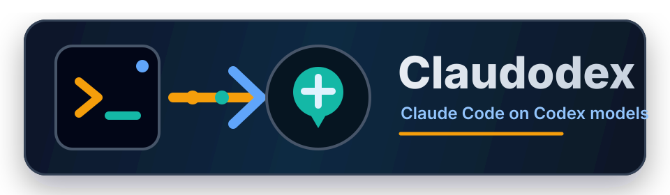

<p align="center">
  
</p>

<p align="center">
  <strong>Claude Code, routed through your OpenAI Codex subscription.</strong>
</p>

<p align="center">
  <a href="LICENSE"></a>
  
  
</p>

Claudodex is a focused launcher and compatibility proxy for running the real
`claude` binary against OpenAI Codex subscription models. It is not a
multi-provider proxy, not a Codex CLI wrapper, and not a replacement terminal
UI. You still use Claude Code. Claudodex swaps the model backend.

```text
you -> claudodex -> installed claude -> local Anthropic-compatible proxy -> Codex
```

## Quickstart

You need macOS on Apple Silicon, Homebrew, a working `claude` command, and an
OpenAI account with Codex subscription access.

```sh
brew install bassner/tap/claudodex
claudodex clx:auth-login
claudodex
```

Homebrew uses a prebuilt bottle when available; otherwise it installs Go and
builds from pinned source. Claude Code is installed separately. If your Claude
version is unsupported, see [Compatibility](#compatibility).

## Why Claudodex?

There are already useful projects in this space, including Claudish,
ccproxy-api, claude-code-proxy variants, and Codex proxy experiments. Many of
them try to support a long list of providers, models, transports, and runtime
styles. That flexibility is valuable, but it can also make the Claude Code plus
Codex subscription path harder to install, harder to reason about, or easier to
miss in small compatibility details.

Claudodex deliberately takes the opposite shape: one launcher, one target use
case, and as little setup as possible. The goal is that a person with a Codex
subscription and an installed `claude` binary can log in once, run `claudodex`,
and get a Claude Code experience whose backend is Codex.

Why not call it `claudex`? Because that name is already used in multiple places.
`Claudodex` is clunkier, but it is specific and searchable.

## What It Does

- Runs your installed `claude` binary with normal Claude Code flags.
- Authenticates to OpenAI through `claudodex clx:auth-login`.
- Maps Claude model families to Codex models:
  - Opus -> `gpt-6.1-sol`
  - Sonnet -> `gpt-6.1-terra`
  - Haiku -> `gpt-6-luna`
  - Fable -> `gpt-6-astra`
- Maps Claude Code `max` effort to Codex `max` for the configured GPT-6 family models. Claude Code's
  `ultracode` mode enables its workflow orchestration while still sending
  Codex `max` effort; older models fall back to their highest supported level.
- Disables Claude Code's deferred tool-search protocol so complete tool
  definitions are sent through the Codex-compatible request path.
- Fetches live Codex model metadata for context windows, model capabilities, and
  auto-compact limits.
- Uses the token usage reported by completed OpenAI responses for Claude Code's
  context accounting. Local preflight estimates exclude base64 payload text and
  count image tokens from the decoded pixel dimensions instead.
- Shows OpenAI reasoning summaries through Claude Code's native thinking UI,
  with each titled summary section kept as a separate thinking entry.
- Preserves encrypted OpenAI reasoning items for lossless stateless tool-call
  continuations while keeping Responses API storage disabled.
- Keeps Claude Code settings shared with normal Claude Code while keeping
  Claudodex auth isolated.
- Sets Claude privacy flags by default:
  `CLAUDE_CODE_DISABLE_NONESSENTIAL_TRAFFIC=1`, `DISABLE_TELEMETRY=1`,
  `DO_NOT_TRACK=1`, and `DISABLE_GROWTHBOOK=1`.
- Provides Codex-backed usage through `claudodex clx:usage`.

## Compatibility

Claudodex is experimental. Compatibility patches require an exact registered
OS, architecture, version, and SHA256. The current verified platform is macOS arm64, including
Claude Code 2.1.314. If the installed Claude version has no supported patch,
whether older or newer, Claudodex uses a verified local copy from its cache or
Claude's retained versions without changing system Claude. If none is available,
launch stops with recovery steps:

```sh
claude install 2.1.314
claudodex clx:doctor
```

Claudodex does not download Claude or create patches automatically.
`CLAUDODEX_DISABLE_CLAUDE_PATCH=1 claudodex` explicitly permits unpatched Claude;
that combination and other platforms are unverified. Help, version, and Claude's
administrative subcommands remain available for repair.

## Updates

Top-level launches check signed GitHub release metadata before starting Claude.
Automatic prompts require standard input, output, and error to be terminals.
For Homebrew installations, an interactive launch shows the installed and
available versions, signed release notes, and release URL, then asks:

```text
Update Claudodex now? [y/N]
```

The default is No. Declining, empty input, EOF, or cancellation keeps the current
version; the next launch checks again. After Yes, Claudodex refreshes Homebrew
metadata and runs `brew upgrade --formula --yes bassner/tap/claudodex`. Homebrew
manages required dependencies. A source fallback may install Go and take longer.
The accepted version takes effect in the same invocation, with the original
Claude arguments. Running sessions keep their pinned statusline helper.

Automatic checks in piped and one-shot runs only print an update notice when a
newer version is available. They do not prompt or replace the running program.
Tool invocations inside a Claudodex session skip the update check. Source and
unknown installations also notify only; rebuild them manually. No scheduler is
installed.

```sh
claudodex clx:update        # Check now and ask on a terminal
claudodex clx:update --yes  # Explicit script consent for a Homebrew update
```

Set `CLAUDODEX_NO_AUTO_UPDATE=1` to skip launch checks. An offline or failed check
keeps the current runtime; `clx:update` reports check errors. If signed update
information requires a newer client, follow the displayed manual Homebrew
upgrade command.

Update metadata uses an embedded Ed25519 public key. Install the initial package
from the trusted tap. A lost or compromised signing key requires a separately
verified package update; automatic key recovery is not supported.

## Install From Source

For a manual installation, use Go 1.25 or newer:

```sh
git clone https://github.com/bassner/claudodex.git
cd claudodex
go build -o claudodex ./cmd/claudodex
mkdir -p ~/.local/bin
install -m 0755 claudodex ~/.local/bin/claudodex
```

Ensure `~/.local/bin` is on your `PATH`. Source builds require manual updates:
pull the latest changes, rebuild, and repeat the install step. When moving to
Homebrew, check `command -v claudodex` and remove any older source copy that
shadows the Homebrew installation.

## Usage

All normal Claude Code arguments are passed through:

```sh
claudodex -p "Reply with exactly: ok"
claudodex --model opus
claudodex --continue
```

## Commands

```sh
claudodex clx:auth-login
claudodex clx:auth-status
claudodex clx:auth-logout
claudodex clx:version
claudodex clx:doctor
claudodex clx:usage
claudodex clx:update
claudodex clx:update --yes
claudodex clx:reset-installation-id
claudodex clx:serve --host 127.0.0.1 --port 0
claudodex [normal claude args...]
```

`claudodex --help` and `claudodex --version` intentionally execute `claude`
directly. Use `claudodex clx:version` for the Claudodex version.

## Model Overrides

Default model targets are centralized and can be changed at startup:

```sh
claudodex --claudodex-opus-model gpt-opus-next
claudodex --claudodex-sonnet-model gpt-sonnet-next --model sonnet
claudodex --claudodex-haiku-model gpt-haiku-next
claudodex --claudodex-fable-model gpt-astra-next
claudodex --claudodex-models opus=gpt-opus-next,sonnet=gpt-sonnet-next,haiku=gpt-haiku-next,fable=gpt-astra-next
```

Overrides affect routing, model argument rewriting, `/v1/models`, capability
cache, statusline context, auto-compact limits, effort handling, and settings
normalization. The selected Codex models must appear in live Codex model
metadata with context-window information.

## Settings And Privacy

Claudodex uses a Claude Code compatibility sidecar under `~/.claudodex`, but
normal Claude Code settings remain the source of truth where possible:

- If another Claude wrapper saved an unrecognized provider model, Claudodex uses
  its Opus route for that launch and leaves the shared model setting unchanged.
- Statusline commands receive the selected Codex model name through a
  Claudodex-owned wrapper; the original statusline script is not changed.
- `~/.claude/` files such as settings, agents, plugins, MCP config, and project
  state are symlinked into the sidecar.
- `~/.claude.json` is mirrored instead of symlinked because it also contains
  account and API-key state.
- Non-auth settings are reconciled before launch, while Claude is running, and
  during shutdown.
- Fake Claude OAuth state for the local compatibility layer stays isolated in
  Claudodex's sidecar.

Claudodex also restores the user's original proxy and shell environment for
Claude Code tool subprocesses, so Bash commands do not inherit Claudodex's
internal API proxy.

## Diagnostics

`clx:doctor` checks whether `claude` is installed, whether Claudodex auth is
present, and whether Codex usage is reachable. `clx:usage` prints Codex-backed
usage windows directly.

Claude Code's built-in `/usage` command is still subject to Claude Code's own
essential-traffic privacy gate. Claudodex keeps that privacy flag enabled, so
`clx:usage` is the reliable usage command for now.

Codex generation requests wait up to 45 seconds for upstream response headers
and retry that wait once. This does not limit an SSE response body after its
headers arrive. Set `CLAUDODEX_CODEX_RESPONSE_HEADER_TIMEOUT` to a duration
such as `90s`, a number of seconds, or `off` to override that behavior.

## Development

```sh
git ls-files '*.go' | xargs gofmt -w
go test -count=1 ./...
go vet ./...
go build -o ./claudodex ./cmd/claudodex
```

Optional installed-Claude smoke test:

```sh
CLAUDODEX_RUN_INSTALLED_CLAUDE_SMOKE=1 \
  go test -count=1 ./internal/launcher \
  -run TestInstalledClaudePrintSmokeWithFakeCodexUpstream -v
```

Live checks require a completed `clx:auth-login`:

```sh
./claudodex -p "Reply with exactly: ok"
./claudodex clx:usage
```

## Contributing

Contributions are welcome, especially compatibility fixes for new Claude Code
versions and Codex response shapes. Please read [CONTRIBUTING.md](CONTRIBUTING.md)
before opening a pull request.

## License

MIT. See [LICENSE](LICENSE).
